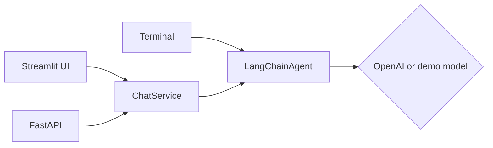

# Personal Chatbot

[](https://github.com/Machine-Learning-Collective/gustaw-mateusz-speedrun/actions/workflows/tests.yml)

A conversational chatbot built in **ML Kolektyw** (Machine Learning Collective, PJATK) by Gustaw Pluta ([@GustawP](https://github.com/GustawP)) and Mateusz ([@mmalimon](https://github.com/mmalimon)).

It talks to an OpenAI model through LangChain, remembers each conversation separately, and can be used from a web UI, a REST API or the terminal. Without an API key it starts in demo mode, so it runs anywhere.

The project was built in stages: every technology was researched and validated before any code was written, every component was built and tested in isolation, and only then were the pieces connected.

## Stack

| Layer | Technology | Role |
|---|---|---|
| Conversation logic | **LangChain** | Prompt, model abstraction, OpenAI integration |
| Data contracts | **Pydantic v2** | Validated models for every message crossing a component boundary |
| UI | **Streamlit** | Chat interface |
| API | **FastAPI** | REST endpoints with automatic validation and docs |
| Tests | **pytest** | 54 tests, run in GitHub Actions on every push |
| Environment | **uv**, Python 3.13 | Dependencies pinned in `uv.lock` |

## Status

| Milestone | Scope | |
|---|---|---|
| 1 | Research and technology validation | ✅ [notes](docs/milestone-1-research.md) |
| 2 | Isolated components | ✅ |
| 3 | Integration and demo | ✅ [notes](docs/milestone-3-integration.md) |
| 4 | Reflection and handoff | ✅ [notes](docs/milestone-4-reflection.md) |

## Running it

```bash
uv sync

# Optional: talk to a real model
cp .env.example .env    # then put your OPENAI_API_KEY in .env

# Web UI
uv run streamlit run src/Streamlit_Interface/app.py

# REST API (docs at http://localhost:8000/docs)
uv run uvicorn FastApi_Skeleton.main:app --app-dir src

# Terminal
uv run python main.py

# Tests
uv run pytest
```

Without a key, every interface runs in **demo mode**: the bot repeats your message and says how many earlier messages it can see, which shows that the conversation history reaches the model.

### Configuration

| Variable | Default | |
|---|---|---|
| `OPENAI_API_KEY` | – | Enables OpenAI |
| `OPENAI_MODEL` | `gpt-5-mini` | Model name |
| `LLM_PROVIDER` | auto | `openai` or `demo` |
| `LLM_TEMPERATURE` | model default | Ignored by models that only accept their default |
| `LLM_TIMEOUT_SECONDS` | `60` | Per-request timeout |

## How it fits together



```
src/
├── Pydantic_Base_Models/            Message, ChatRequest, ChatResponse, ConversationConfig
├── LangChain_Conversational_Agent/  Agent with per-session history; model factory; CLI
├── Chat_Service/                    Single entry point for API and UI
├── FastApi_Skeleton/                REST API
└── Streamlit_Interface/             Web UI
```

### API

| Method | Path | |
|---|---|---|
| `GET` | `/health` | Status and active model |
| `POST` | `/chat` | Send a message, get the reply and the session history |
| `GET` | `/sessions/{id}/messages` | Session history |
| `DELETE` | `/sessions/{id}` | Clear a session |

```bash
curl -X POST localhost:8000/chat -H 'content-type: application/json' \
  -d '{"session_id": "demo", "message": {"role": "user", "content": "Hello!"}}'
```

## Documentation

| Document | |
|---|---|
| [milestone-1-research.md](docs/milestone-1-research.md) | All Milestone 1 decisions: provider, versions, testing, architecture |
| [langchain-core-abstractions.md](docs/langchain-core-abstractions.md) | Chat models, prompts, runnables, memory |
| [pydantic-message-handling.md](docs/pydantic-message-handling.md) | Message models, validation, serialization |
| [streamlit-chat-ui-interaction.md](docs/streamlit-chat-ui-interaction.md) | Chat elements, session state, rerun model |
| [version-compatibility-validation.md](docs/version-compatibility-validation.md) | Version matrix and dependency resolution |
| [milestone-3-integration.md](docs/milestone-3-integration.md) | Architecture, decisions, bugs found during integration |
| [milestone-4-reflection.md](docs/milestone-4-reflection.md) | What worked, what did not, known limitations, handoff |
| [project-brief.md](docs/project-brief.md) | The original brief |

## Team

| | Role |
|---|---|
| Gustaw Pluta | Project lead; research and technology validation (M1); integration and handoff (M3–M4) |
| Mateusz (@mmalimon) | Isolated components and tests (M2) |

Work happens on milestone branches and is merged through reviewed pull requests.
