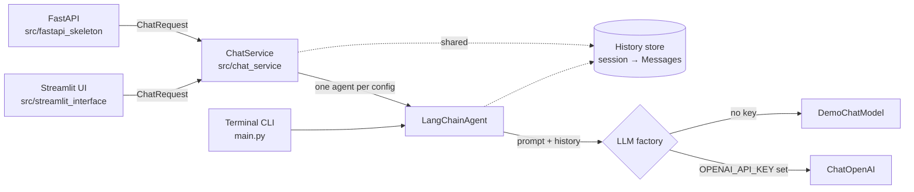

# Milestone 3: Integration & Demo

> *"Witness me"*

Milestone 2 left four components that worked alone: data models, an agent running on a scripted test model, a Streamlit shell with a mock responder, and a FastAPI app with only `/health`. This milestone connects them to each other and to a real language model.

A first integration was written by Mateusz in December 2025 on the `milestone-3/End-to-End-Demo` branch: it connected the agent to OpenAI, added a `/chat` endpoint and made the Streamlit UI call the API. That branch was never merged and could not run in CI (its tests needed a live API key). The version merged here was rebuilt on `main` with demo mode, a shared service layer and full test coverage. Ideas worth carrying over from his branch are listed under [Next steps](#next-steps).

## Architecture

Everything above the agent speaks only in Pydantic models: `ChatRequest` goes in, `ChatResponse` comes out. The agent converts to LangChain messages only for the model call.

## Decisions

### Demo mode instead of a required API key
Without `OPENAI_API_KEY` the app runs on `DemoChatModel`, which repeats the last message and reports how many earlier messages it received. Anyone can clone and run the project, CI needs no secrets, and the demo reply visibly proves that history reaches the model on every turn.

### Own history store instead of `RunnableWithMessageHistory`
Milestone 2 used `RunnableWithMessageHistory` and `InMemoryChatMessageHistory`. Both are deprecated as of langchain-core 1.6. The replacement LangChain recommends (LangGraph persistence) would add a framework for what is a dictionary of lists, so the agent now keeps history itself, as validated `Message` objects. This also let us drop `langchain-community`, which is being sunset.

### `ChatService` as the single entry point
The API and the UI need the same thing: take a request, run a turn, return the reply and history. Putting that in one class means one place for session locking and configuration handling, and the Milestone 2 UI shell, which kept its own second copy of the history, could be removed. Its tests (turn order, session isolation, reset) were carried over to `ChatService`.

### Configuration overrides keep the history
A request may carry `config_overrides`, for example a different system prompt. The service keeps one agent per distinct configuration, and all agents share one history store, so changing the prompt mid-conversation does not start a new conversation.

### Errors at the right layer
| Situation | API | UI |
|---|---|---|
| Empty message, message over 4000 characters, non-user role, empty session id | 422 from Pydantic before any model call | Validation message, nothing sent |
| Provider failure (timeout, invalid key, outage) | 502, details only in the server log | "The language model request failed" |
| Unknown session | 404 on `GET /sessions/{id}/messages` | – |

## Bugs found while integrating

These passed every Milestone 2 test and only showed up once real data flowed through the system.

1. **Any model reply over 4000 characters crashed the conversation.** The 4000-character limit applied to every `Message`, including model replies, and history was validated when read back. A long answer from a real model made `get_history()` raise, which would have been a 500 from the API. The limit now applies to user messages only.
2. **Empty input poisoned the history.** `send("")` stored the empty message, and the next `get_history()` raised. The Milestone 2 test was named *does not crash* and only checked `send()`; the crash happened one call later. Invalid input is now rejected before it is stored.
3. **Braces in the system prompt broke the prompt.** The system prompt was passed as a template string, so a prompt such as `Answer as {"result": ...}` was parsed for variables and failed. It is now passed as a message object.
4. **A failed model call left an orphan user message**, so a retry duplicated it. History is now written only after a successful reply.
5. **`uv run pytest` could not run.** Test discovery did not include `src/`, the API tests needed `httpx` which was not a dependency, and `uv.lock` was in `.gitignore`, so no two environments were guaranteed to match.

## API

| Method | Path | Body / response |
|---|---|---|
| `GET` | `/health` | `HealthResponse` incl. active `llm_provider` |
| `POST` | `/chat` | `ChatRequest` → `ChatResponse` |
| `GET` | `/sessions/{session_id}/messages` | `List[Message]`, 404 if unknown |
| `DELETE` | `/sessions/{session_id}` | 204 |

Interactive documentation is at `/docs` when the API is running.

## Configuration

| Variable | Default | Meaning |
|---|---|---|
| `OPENAI_API_KEY` | – | Enables the OpenAI provider |
| `OPENAI_MODEL` | `gpt-5-mini` | Model name |
| `LLM_PROVIDER` | auto | `openai` or `demo`; overrides the automatic choice |
| `LLM_TEMPERATURE` | model default | Ignored by models that only accept their default, such as the GPT-5 family |
| `LLM_TIMEOUT_SECONDS` | `60` | Per-request timeout |

Put them in `.env` (see `.env.example`). Tests force `LLM_PROVIDER=demo`, so a key in `.env` is never used by the test suite.

## Tests

54 tests, up from 25, all running without network access:

| Area | Tests |
|---|---|
| Data models | 14 |
| Agent | 13 |
| LLM factory | 9 |
| Chat service | 6 |
| API | 8 |
| Streamlit UI (AppTest) | 4 |

They run on every push and pull request in GitHub Actions (`.github/workflows/tests.yml`).

## Next steps

From Mateusz's December branch, not yet in `main`:
- **UI talking to the API** instead of calling the service directly, so the UI and API share one conversation history.
- **Agent built with `create_agent`** and a `tools.py` prepared for retrieval (RAG), which is the natural way to give the bot access to documents.
